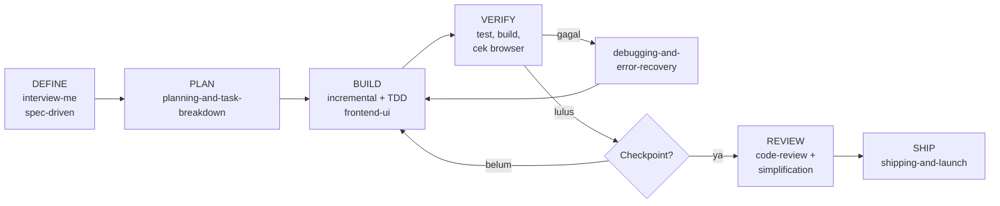

# Workflow Pengerjaan

Mengikuti lifecycle agent-skills, dipangkas untuk proyek 1 orang.



## Fase & Gate

| Fase | Input | Output | Gate (wajib lulus sebelum lanjut) |
|---|---|---|---|
| DEFINE | ide | `spec/SPEC.md` disetujui | Open Questions terjawab, kamu bilang "setuju" |
| PLAN | spec | `tasks/plan.md`, `tasks/todo.md` | Urutan & ukuran task disetujui |
| BUILD | 1 task | kode + test + 1 commit | Acceptance criteria task tercentang |
| VERIFY | commit | — | `npm test && npm run build` hijau + cek manual |
| REVIEW | 2–4 task | catatan review | Tidak ada temuan "Critical" |
| SHIP | semua task | URL / build lokal | Success Criteria spec tercentang |

## Loop per Task (BUILD → VERIFY)

1. Ambil task teratas yang belum selesai di `tasks/todo.md`.
2. Baca acceptance criteria + file terkait. **Jangan sentuh file di luar task.**
3. Logika di `src/lib/`: tulis test gagal dulu → buat lulus → rapikan.
4. UI: bangun dengan token dari `styles/tokens.css`, cek di viewport 375 px & 1280 px, terang & gelap.
5. `npm test && npm run build`.
6. Centang task di `tasks/todo.md`.
7. Commit: `feat(tx): catat pengeluaran dari keypad` (format di `docs/coding-rules.md`).
8. `git push` → Cloudflare Pages deploy otomatis → cek di HP.

## Prompt Siap Pakai (agy)

```text
# DEFINE
/agent-skills:interview-me  Baca spec/SPEC.md, tanyakan Open Questions satu per satu, lalu perbarui spec.

# PLAN
/agent-skills:planning-and-task-breakdown  Spec sudah disetujui. Validasi tasks/plan.md terhadap spec, buat tasks/todo.md.

# BUILD (ulangi per task)
/agent-skills:incremental-implementation  Kerjakan task berikutnya di tasks/todo.md. Patuhi AGENTS.md.

# REVIEW (di checkpoint)
/agent-skills:code-review-and-quality  Review semua commit sejak checkpoint terakhir.

# SHIP
/agent-skills:shipping-and-launch  Jalankan checklist rilis terhadap Success Criteria di spec/SPEC.md.
```

## Aturan Kerja Agent

- Satu sesi = satu task. Konteks penuh → mulai sesi baru, baca `AGENTS.md` + task.
- Ragu soal requirement → **tanya**, jangan menebak.
- Butuh dependency baru / ubah bentuk `Db` / ubah token desain → **tanya dulu**.
- Test gagal → perbaiki akar masalahnya. Jangan hapus/skip test.
